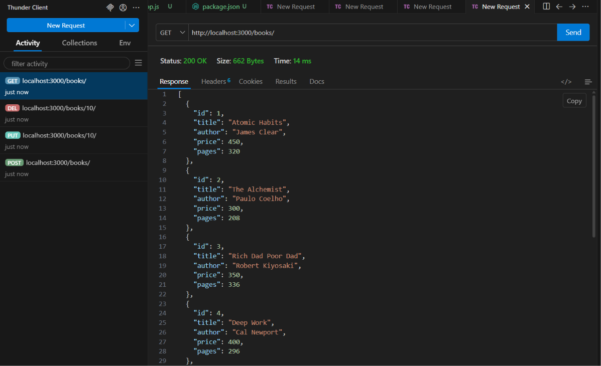
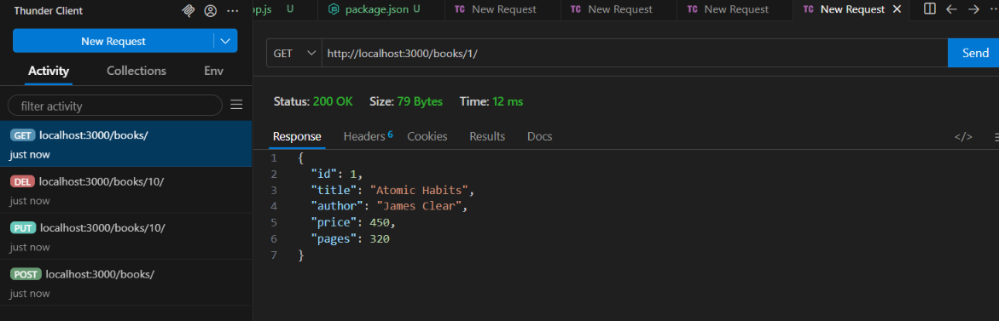
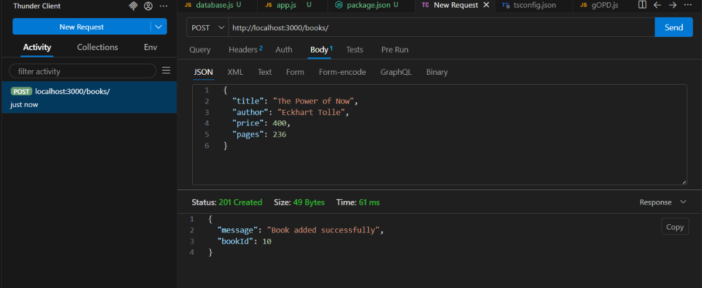
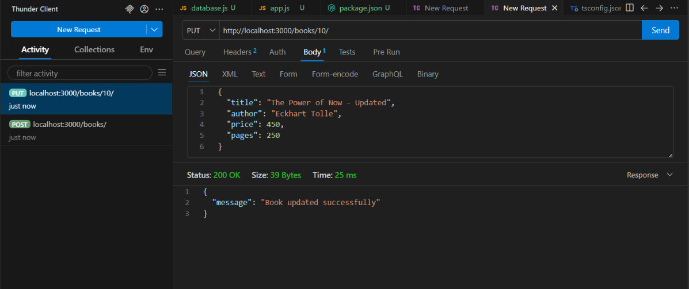
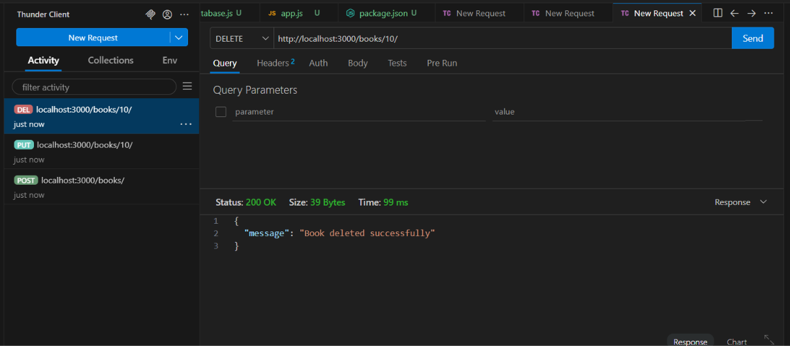

# Lab 2: SQLite Database and CRUD Routes

## Student Details

- **Name:** [RAYABARAPU SRIRAM]
- **Registration Number:** [252U1R9136]
- **Section:** [CSE(GENAI)2C&112]
- **Subject:** Backend Development Fundamentals
- **Lab:** Lab 2 – SQLite Database and CRUD Routes

---

## 1. Objective

To connect an Express.js server with an SQLite database and implement CRUD (Create, Read, Update, Delete) operations using REST API routes.

## 2. Technologies Used

- Node.js
- Express.js
- SQLite
- SQLite3
- JavaScript
- Nodemon
- Thunder Client
- Visual Studio Code

## 3. Project Structure

```text
lab-02/
│
├── app.js
├── database.js
├── books.db
├── package.json
├── package-lock.json
├── .gitignore
├── README.md
│
└── Screenshots/
    ├── 01-server.png
    ├── 02-get-all-books.png
    ├── 03-get-book-by-id.png
    ├── 04-get-invalid-id.png
    ├── 05-post-book.png
    ├── 06-put-book.png
    ├── 07-delete-book.png
    └── 08-delete-verification.png
```

## 4. Installation

Install the required dependencies:

```bash
npm install
```

The required packages are:

```bash
npm install express sqlite sqlite3@5.1.7
npm install --save-dev nodemon
```

## 5. Running the Application

Start the development server using:

```bash
npm run dev
```

The server runs at:

```text
http://localhost:3000/
```

## 6. Database Details

Database name: `books.db`

Table name: `book`

Table structure:

| Column | Data Type | Description |
|---|---|---|
| id | INTEGER | Primary key |
| title | TEXT | Book title |
| author | TEXT | Author name |
| price | INTEGER | Book price |
| pages | INTEGER | Number of pages |

Eight sample book records were inserted into the database.

## 7. API Endpoints

### 1. GET All Books

- **Method:** GET
- **Endpoint:** `/books/`
- **Description:** Retrieves all books from the database.

### 2. GET Book by ID

- **Method:** GET
- **Endpoint:** `/books/:bookId/`
- **Description:** Retrieves a specific book using its ID.

### 3. POST Add a New Book

- **Method:** POST
- **Endpoint:** `/books/`
- **Description:** Adds a new book to the database.

Example JSON:

```json
{
  "title": "The Power of Now",
  "author": "Eckhart Tolle",
  "price": 400,
  "pages": 236
}
```

### 4. PUT Update a Book

- **Method:** PUT
- **Endpoint:** `/books/:bookId/`
- **Description:** Updates the details of an existing book.

### 5. DELETE a Book

- **Method:** DELETE
- **Endpoint:** `/books/:bookId/`
- **Description:** Deletes a book from the database using its ID.

## 8. Screenshots

### GET All Books



### GET Book by ID



### POST Add Book



### PUT Update Book



### DELETE Book




## 9. Testing

All five CRUD operations were tested using Thunder Client.

| Operation | Method | Status |
|---|---|---|
| Get all books | GET | Successful |
| Get book by ID | GET | Successful |
| Add a book | POST | 201 Created |
| Update a book | PUT | 200 OK |
| Delete a book | DELETE | 200 OK |

The database was also checked using the SQLite command-line interface.

## 10. Security and Best Practices

- Used parameterized SQL queries with `?` placeholders.
- Used Express JSON middleware to process request bodies.
- Used appropriate HTTP status codes.
- Added error handling for database initialization.
- Used Nodemon for automatic server restarts.
- Excluded `node_modules` and `.env` from version control.

## 11. Conclusion

Successfully connected an Express.js application to an SQLite database and implemented all five CRUD API operations.

Tested the API endpoints using Thunder Client and verified database records using SQLite CLI.

**Lab 2 completed successfully.**
