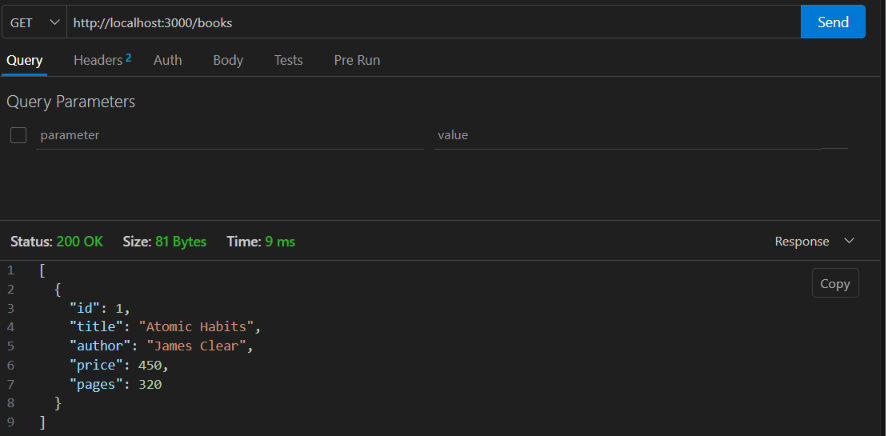
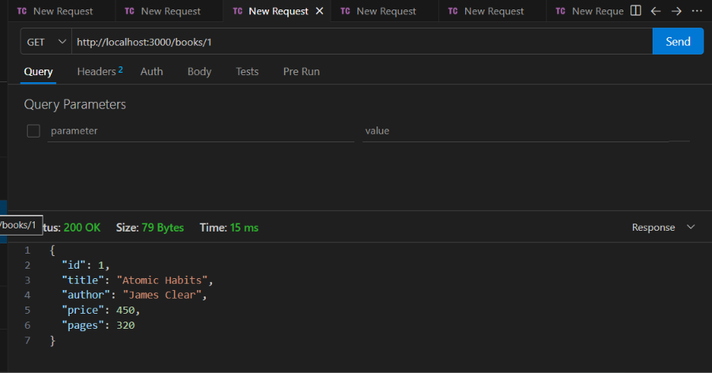
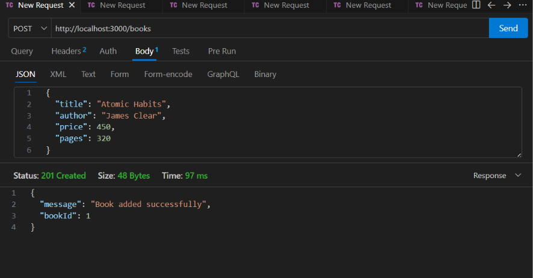
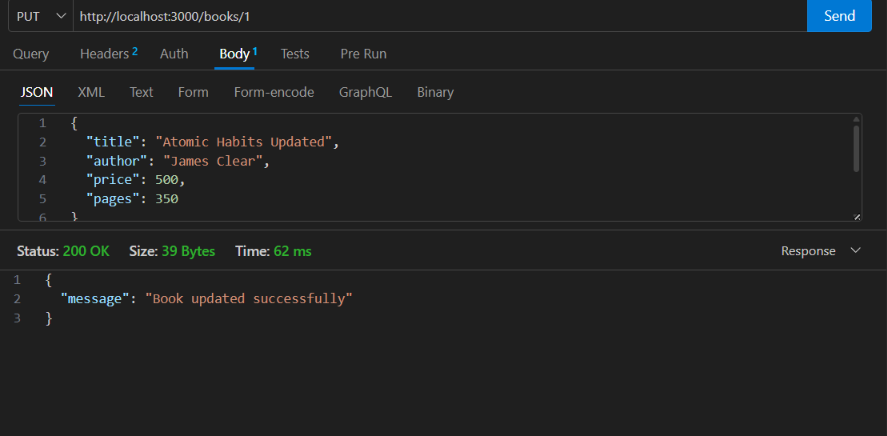
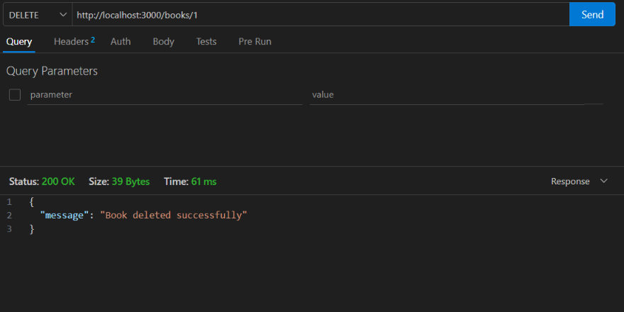
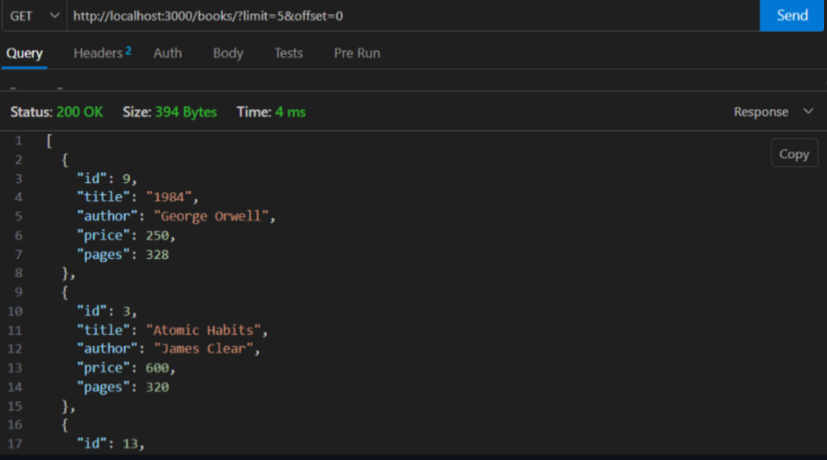

# Lab 3: REST API with SQLite – Query Parameters, Sorting, Pagination and Validation

**Subject:** Backend Development Fundamentals  
**Year/Term:** Year II, Term II  
**University:** Aurora Deemed to be University  
**Faculty:** Mr. Joel Prashanth D

## Student Details

| Field | Details |
|---|---|
| Name | RAYABARAPU SRIRAM |
| Registration Number | 252U1R9136 |
| Section | S-26 |

Live Deployment Link:  https://backend-development-fundamentals-la-one.vercel.app/books

## Project Objective

This lab demonstrates the development of a REST API using Node.js, Express.js and SQLite. It extends basic CRUD operations by implementing query parameters, searching, sorting, pagination, price filtering and input validation.

The application allows users to create, retrieve, update and delete book records stored in an SQLite database.

The project also includes error handling, HTTP status codes and parameterized SQL queries to improve data safety and reliability.

## Technologies Used

- Node.js
- Express.js
- SQLite
- SQLite3
- JavaScript (CommonJS)
- npm
- Thunder Client
- HTTP methods and JSON responses

## Project Folder Structure

```text
lab3/
├── app.js
├── database.js
├── books.db
├── package.json
├── package-lock.json
├── README.md
└── Screenshots/
    ├── GET.png
    ├── GET1BOOK.png
    ├── POST.png
    ├── PUT.png
    └── DELETE.png
```

## Installation and Execution

### Prerequisites

- Node.js and npm installed on the computer.
- Visual Studio Code or Antigravity editor.
- SQLite database support.
- Thunder Client extension for API testing.

### Install Dependencies

Open a terminal in the project directory and run:

```bash
npm install
```

### Run the Application

Start the server using:

```bash
npm start
```

Alternatively, run:

```bash
node app.js
```

The server runs on port 3000 by default.

Expected server message:

```text
Server running at http://localhost:3000/
```

The API can be tested using Thunder Client or another API testing tool.

## Database Structure

The project uses an SQLite database named `books.db`.

The database contains a table named `book` with the following columns:

| Column | Data Type | Description |
|---|---|---|
| id | INTEGER | Primary key with auto-increment |
| title | TEXT | Book title |
| author | TEXT | Author name |
| price | REAL | Book price |
| pages | INTEGER | Number of pages |

The table is created automatically when the application starts if it does not already exist.

## API Endpoints

| HTTP Method | Path | Description | Expected Status Code |
|---|---|---|---|
| GET | `/books` | Retrieves books with search, sorting, pagination and price filters | 200 |
| GET | `/books/:bookId` | Retrieves a specific book by ID | 200 / 404 |
| POST | `/books` | Adds a new book | 201 |
| PUT | `/books/:bookId` | Updates an existing book | 200 / 400 / 404 |
| DELETE | `/books/:bookId` | Deletes a book by ID | 200 / 404 |

## Query Parameters

The GET `/books` endpoint supports the following query parameters:

| Parameter | Description | Example |
|---|---|---|
| search_q | Searches books by title | `search_q=Atomic` |
| order_by | Sorts using an allowed column | `order_by=price` |
| order | Sorting direction (ASC or DESC) | `order=DESC` |
| limit | Maximum number of records | `limit=5` |
| offset | Number of records to skip | `offset=0` |
| min_price | Minimum book price | `min_price=200` |
| max_price | Maximum book price | `max_price=500` |

### Example Requests

Retrieve all books:

```text
http://localhost:3000/books
```

Retrieve a specific book:

```text
http://localhost:3000/books/1
```

Search books by title:

```text
http://localhost:3000/books?search_q=Atomic
```

Sort books by price in descending order:

```text
http://localhost:3000/books?order_by=price&order=DESC
```

Retrieve books with pagination:

```text
http://localhost:3000/books?limit=5&offset=0
```

Filter books by price:

```text
http://localhost:3000/books?min_price=200&max_price=500
```

Combine search, sorting, pagination and price filters:

```text
http://localhost:3000/books?search_q=Atomic&order_by=price&order=ASC&limit=5&offset=0&min_price=200&max_price=500
```

## CRUD Operations

### 1. GET – Retrieve Books

The GET method retrieves all books from the SQLite database. It also supports searching, sorting, pagination and price filtering.

A separate GET endpoint retrieves a book using its ID.

### 2. POST – Add a New Book

The POST method inserts a new book into the database.

Example JSON request body:

```json
{
  "title": "Atomic Habits",
  "author": "James Clear",
  "price": 450,
  "pages": 320
}
```

Expected response:

```json
{
  "message": "Book added successfully",
  "bookId": 1
}
```

Expected status code: `201 Created`

### 3. PUT – Update a Book

The PUT method updates an existing book using its ID.

Example JSON request body:

```json
{
  "title": "Atomic Habits Updated",
  "author": "James Clear",
  "price": 500,
  "pages": 350
}
```

Expected response:

```json
{
  "message": "Book updated successfully"
}
```

Expected status code: `200 OK`

### 4. DELETE – Delete a Book

The DELETE method removes a book from the database using its ID.

Example request:

```text
DELETE http://localhost:3000/books/1
```

Expected response:

```json
{
  "message": "Book deleted successfully"
}
```

Expected status code: `200 OK`

## Input Validation and Error Handling

The application validates user input before performing database operations.

The validation includes:

- Book title must be a non-empty string.
- Author name must be a non-empty string.
- Price must be a valid finite number.
- Pages must be a non-negative integer when provided.
- Sorting columns must belong to the allowed column list.
- Sorting order must be ASC or DESC.
- Limit and offset must contain valid pagination values.
- Minimum price cannot exceed maximum price.
- A book that does not exist returns a 404 response.

The application uses parameterized SQL queries to help prevent SQL injection.

## Screenshots

### 1. GET All Books


### 2. GET Book by ID


### 3. POST - Add a New Book


### 4. PUT - Update a Book


### 5. DELETE - Delete a Book


### 6. Search Books by Title


### 7. Sort Books by Price


### 8. Filter Books by Price Range


### 9. Pagination


### 10. Verify Deletion


### 11. Test Invalid POST Data


### 12. Test Invalid Sorting Order


### 13. Test Invalid order_by Value


### 14. Update a Non-Existing Book


### 15. Delete a Non-Existing Book


## Problems Faced and Solutions

| Problem | Solution |
|---|---|
| Connecting Node.js with SQLite | Used the `sqlite` and `sqlite3` packages. |
| Creating and managing the database | Created the `book` table using SQL commands. |
| Retrieving records using query parameters | Used `request.query` in Express. |
| Implementing sorting safely | Used an allowlist of valid database columns and sorting directions. |
| Implementing pagination | Used SQL `LIMIT` and `OFFSET`. |
| Filtering books by price | Used minimum and maximum price conditions. |
| Validating user input | Added validation checks before database operations. |
| Handling missing book records | Returned an appropriate 404 response. |
| Preventing SQL injection | Used parameterized SQL queries. |

## Learning Outcomes

- Created a REST API using Node.js and Express.js.
- Connected an Express application to an SQLite database.
- Implemented GET, POST, PUT and DELETE operations.
- Retrieved individual records using route parameters.
- Implemented search functionality using query parameters.
- Applied sorting using ASC and DESC.
- Implemented pagination using LIMIT and OFFSET.
- Added minimum and maximum price filtering.
- Implemented input validation and error handling.
- Used parameterized SQL queries.
- Tested REST API endpoints using Thunder Client.
- Learned to organize and upload a backend project to GitHub.

## Git Hygiene

Create a `.gitignore` file in the project root with the following entries:

```text
node_modules/
.env
```

Do not commit `node_modules`, `.env`, passwords, API keys or other secret information to GitHub.

## GitHub Repository

**Repository URL:**

https://github.com/sriramrayabarapu/Backend-Development-Fundamentals-labs

**Lab 3 Folder:**

https://github.com/sriramrayabarapu/Backend-Development-Fundamentals-labs/edit/main/lab3/README.md

## Conclusion

This lab provided practical experience in developing a REST API using Node.js, Express.js and SQLite. It strengthened understanding of CRUD operations, query parameters, searching, sorting, pagination, price filtering and input validation.

The project demonstrates how backend applications manage database records and process client requests using REST API principles.
